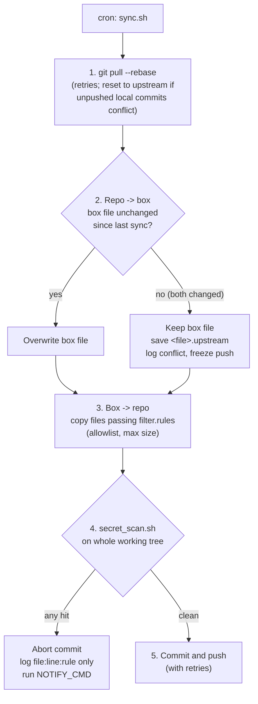

<h1 align="center">git-box-sync</h1>

<p align="center">
  <strong>AI エージェントが動く Linux マシンと git リポジトリを双方向に同期するツールです。許可リストとシークレットスキャンで二重に守り、認証情報らしきものが見つかればコミットを止めます。</strong>
</p>

<p align="center">
  <a href="https://github.com/sdpwh7-ux/git-box-sync/actions/workflows/ci.yml"></a>
  <a href="LICENSE"></a>
  
  
</p>

<p align="center">
  <a href="README.md">English</a> | <a href="README.zh-CN.md">简体中文</a> | <b>日本語</b>
</p>

---

## 🤔 なぜ必要か

共有の Linux マシン（以下「box」）に常駐する AI エージェントのもとには、便利なスクリプトや設定、スキルが次第に溜まっていきます。これらを git で管理できれば、レビューができ、ローカルで（たとえば Codex で）編集して push し、その変更を box 側に取り込めます。

ところが、エージェントのホームディレクトリで安易に `git add -A` を実行すると、API キーや cookie、ログ、個人的なファイルがそのまま GitHub に上がってしまいます。

**git-box-sync** は cron での定期実行（たとえば毎時）を想定した単一の bash スクリプトです。既定の動作はどれも慎重側に倒してあります。許可リストに載ったファイルだけを公開し、box 上の編集を上書きせず、上流の変更を理由に box のファイルを削除しません。シークレットらしきものを検出した場合は**コミットを中止**します。

## ✨ 特長

- 🔁 **双方向同期**：1 回の実行で、リポジトリ → box と box → リポジトリの両方向を同期します。
- 🛡️ **許可リスト優先**：`filter.rules`（rsync フィルタ構文）を通過したファイルだけをコピーします。対象はテキスト/ソースの拡張子で 1 MB 以下のものに限られます。ログ、状態ファイル、バックアップ、`.env`、鍵、証明書、cookie、`*token*`/`*secret*` を含む名前のファイルは除外されます。
- 🔍 **シークレットスキャンでコミットをブロック**：機密ファイル名、秘密鍵ヘッダ、一般的なトークン接頭辞、JWT、UUID、URL 埋め込みパスワード、パスワード/トークンのリテラル代入を検査します。`gitleaks` がインストールされていればそれも併用します。**1 件でも検出されればコミットを中止します。**
- 🙈 **値はログに残らない**：検出結果は `file:line:rule` 形式でのみ記録されます。ログでも通知でも同じです。
- ⚖️ **慎重な競合処理**：両側で同じファイルが変更された場合は box 側を残し、上流版を `<file>.upstream` として保存します。競合を解消するまで、そのファイルの push は凍結されます。
- 🗑️ **慎重な削除処理**：上流で削除されたファイルは、明示的に有効化しない限り box からは消えません。有効化した場合でもゴミ箱フォルダへ移動するだけです。
- 🔔 **中止時の通知**：同期が中止されたとき、任意の `NOTIFY_CMD` フックを実行できます。
- 🧰 **スキャナ単体でも利用可能**：`secret_scan.sh` は任意のディレクトリに対して単独で実行できます。
- 🐚 **依存が少ない**：必要なのは bash、git、rsync、flock、`sha256sum` だけです。Python 3 は gitleaks の出力解析にのみ使います。
- 🧪 **テスト付き**：テストはローカルの bare リポジトリで動き、フィルタリング、pull、競合、シークレットのブロック、削除をカバーしています。

## ⚙️ 仕組み



1. **Pull**：同期用クローンに対して `git pull --rebase` を実行します（失敗時はリトライ）。未 push のローカルコミットが競合した場合は上流にリセットします。box が信頼できる唯一の情報源であり、その変更はステップ 3 で再生成されるためです。
2. **リポジトリ → box**：上流の変更を適用しますが、box 上のファイルを上書きするのは前回の同期以降に変更されていない場合だけです。両側で変更があった場合は box 側を残し、上流版を `<file>.upstream` として保存して競合をログに記録します。解消する（`.upstream` ファイルを削除する）まで、そのファイルの push は凍結されます。
3. **box → リポジトリ**：**許可リスト**（`filter.rules`）を通過した変更ファイルをコピーします。
4. **シークレットスキャン**：`secret_scan.sh` で作業ツリー全体を検査します。対象は機密ファイル名、秘密鍵ヘッダ、一般的なトークン接頭辞（`sk-`、`ghp_`、`github_pat_`、`xox?-`、`AKIA`、`AIza`、Telegram ボットトークン、JWT）、UUID、URL 埋め込みパスワード、パスワード/トークンのリテラル代入で、インストールされていれば `gitleaks` も実行します。**1 件でも検出されればコミットを中止します。** ログに残るのは `file:line:rule` だけで、値そのものは記録されません。
5. **コミットと push**（失敗時はリトライ）。

### 削除のルール

| 状況 | 動作 |
| --- | --- |
| **上流**でファイルが削除された | box からは削除しません。ログに記録し、以後そのファイルは push しません。`APPLY_UPSTREAM_DELETES=1` を設定すると、代わりにゴミ箱フォルダへ移動します。 |
| 追跡中のファイルが **box 上**で削除された | リポジトリからも削除します（履歴から復元可能）。 |
| **両側**でファイルが変更された | box 側を保持し、上流版を `<file>.upstream` として保存、競合をログに記録します。`.upstream` を削除するまで push は凍結されます。 |

## 🚀 クイックスタート

**動作要件：** bash 4+、git、rsync、flock（util-linux）、coreutils の `sha256sum`。Linux のみ対応です。Python 3 は gitleaks 出力の解析にのみ必要です。

```bash
git clone https://github.com/sdpwh7-ux/git-box-sync.git ~/git-box-sync
git clone git@github.com:you/your-private-box-config.git ~/sync/my-box-config
cp ~/git-box-sync/examples/sync.conf.example ~/git-box-sync/sync.conf   # edit REPO / MAP_REPO / MAP_BOX
~/git-box-sync/sync.sh               # first run
crontab -e                           # 23 * * * * $HOME/git-box-sync/sync.sh
```

スキャナは単体でも動作します。検出があると終了コード 1 で終了し、`SECRET-HIT file:line:rule` 形式の行を出力します：

```bash
./secret_scan.sh <dir>
```

## 🔧 設定

`sync.conf` は bash から source されます（`examples/sync.conf.example` を参照）：

| 設定 | 既定値 | 意味 |
| --- | --- | --- |
| `REPO` | 必須 | 同期に使うローカルクローンのパス（手作業で編集しないこと） |
| `MAP_REPO` / `MAP_BOX` | 必須 | 並行配列：リポジトリのトップレベルディレクトリ <-> box のディレクトリ |
| `RULES` | スクリプトと同じ場所の `filter.rules` | 各 box ディレクトリに適用する rsync フィルタルール |
| `STATE` | `~/.local/state/git-box-sync` | マニフェスト、ロック、ゴミ箱、`upstream_deleted.txt` |
| `LOG` | `$STATE/sync.log` | 2 MB でローテーション |
| `MAX_SIZE` | `1m` | これより大きいファイルは同期しない |
| `REMOTE` | `origin` | リモート名 |
| `APPLY_UPSTREAM_DELETES` | `0` | `1` = 上流で削除された box ファイルを `$STATE/trash/` へ移動 |
| `NO_PUSH` | `0` | `1` = ローカルコミットのみ（push しない） |
| `NOTIFY_CMD` | - | 同期中止時に `bash -c` で実行。`$TITLE` と `$BODY` を受け取る |
| `SCANNER` | スクリプトと同じ場所の `secret_scan.sh` | スキャナを差し替える |
| `SECRET_SCAN_ALLOWLIST` | スキャナと同じ場所の `allowlist.txt` | その行の検出を抑制する固定文字列 |

## 🔐 セキュリティモデル

- box の設定には**プライベートリポジトリを使ってください**。許可リストとスキャナはリスクを下げるものであり、ホームディレクトリを公開しても安全になるわけではありません。
- **認証情報。** git-box-sync 自身が鍵ファイルを読むことはありません。既存の git 認証設定に依存します。このリポジトリに*のみ*書き込み権限を持つ SSH デプロイキーの利用を推奨します。シークレットはマッピング対象外のディレクトリ（例：`~/.config/...`）に置いてください。スキャナが報告するのは場所だけで、値は出力しません。ログと通知にも場所しか含まれません。
- **ファイルアクセス。** スクリプトが書き込むのは、マッピングされた box ディレクトリ（pull した変更、`.upstream` コピー）、`REPO`、`STATE` の中だけです。上流の変更を理由に box のファイルを削除することはありません。
- ⚠️ **逆方向も信頼境界です。** リポジトリに push できる人は誰でも box 上のスクリプトを変更でき、エージェントが後でそれを実行する可能性があります。ブランチを保護し、そこへの push はエージェント権限で実行されるコードとしてレビューしてください。
- **シェル。** `sync.conf` は bash として source されます。所有者を自分にし、他のユーザーが書き込めないようにしてください。`NOTIFY_CMD` は `bash -c` で実行されます。
- **ネットワーク。** 設定したリモートに対する `git pull`/`fetch`/`push` しか行いません。
- **スキャナの限界。** 正規表現と gitleaks は一般的な形式を検出しますが、すべてを検出できるわけではありません（例：コメント内の裸のパスワード）。スキャン結果がクリーンでも保証ではなく、あくまで安全網として扱ってください。

## 🧪 テスト

```bash
bash tests/test_sync.sh    # local bare repo; covers filtering, pull, conflict, secret block, deletions
```

## 🗺️ プロジェクトの状況

git-box-sync は**オープンソース化されたばかり**です。小さな単一の bash スクリプトで、上記の主要な処理経路をテストでカバーしています。対応 OS は Linux のみです。

特に次の点についてフィードバックを歓迎します：

- `secret_scan.sh` の誤検出・検出漏れ
- `filter.rules` の既定の許可リスト
- 競合・削除処理まわりの分かりにくい挙動や予想外の挙動

設定キーはまだ初期段階です。本番の box でアップグレードする前に、変更履歴やコミット履歴を確認してください。

## 🤝 コントリビュート

Issue と Pull Request を歓迎します。

1. リポジトリを Fork してブランチを作成します。
2. 変更は小さく保ち、スクリプトの依存も最小限に抑えてください。
3. `bash tests/test_sync.sh` を実行して通ることを確認してください。同期やスキャンに新しい挙動を加える場合はテストケースも追加してください。
4. 挙動の変化を説明した Pull Request を作成します。

**Issue、PR、テストフィクスチャに本物のシークレットを含めないでください。** スキャナをすり抜ける方法を見つけた場合は、本物の値を貼らずに*パターン*を説明してください。

## 📄 ライセンス

[MIT](LICENSE)

---

### 🧩 エージェントツールキットの一部

| リポジトリ | |
| --- | --- |
| [taskwake](https://github.com/sdpwh7-ux/taskwake) | |
| [agent-search-kit](https://github.com/sdpwh7-ux/agent-search-kit) | |
| [streamsafe](https://github.com/sdpwh7-ux/streamsafe) | |
| [agent-usage-ledger](https://github.com/sdpwh7-ux/agent-usage-ledger) | |
| [git-box-sync](https://github.com/sdpwh7-ux/git-box-sync) | 📍 このリポジトリ |
