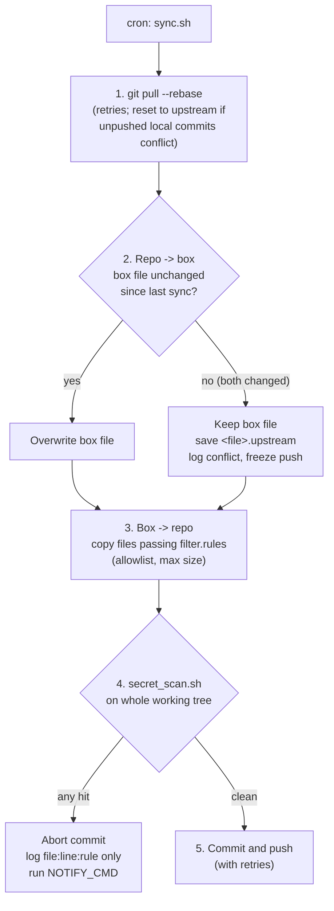

<h1 align="center">git-box-sync</h1>

<p align="center">
  <strong>Two-way sync between an AI agent's Linux box and a git repo, guarded by an allowlist and a secret scan that blocks any commit containing what looks like a credential.</strong>
</p>

<p align="center">
  <a href="https://github.com/sdpwh7-ux/git-box-sync/actions/workflows/ci.yml"></a>
  <a href="LICENSE"></a>
  
  
</p>

<p align="center">
  <b>English</b> | <a href="README.zh-CN.md">简体中文</a> | <a href="README.ja.md">日本語</a>
</p>

---

## 🤔 Why

AI agents that live on a shared Linux box build up useful scripts, configs and skills over time. You want those in git so you can review them, edit them locally (for example with Codex), push, and have the box pick up the changes.

The problem is that a naive `git add -A` from an agent's home directory is how API keys, cookies, logs and personal files end up on GitHub.

**git-box-sync** is a single bash script meant to run from cron (for example hourly). Its defaults are cautious: it publishes only allowlisted files, never overwrites edits made on the box, never deletes box files because of upstream changes, and **refuses to commit** if anything looks like a secret.

## ✨ Features

- 🔁 **Two-way sync**: changes flow from repo to box and from box to repo in a single run.
- 🛡️ **Allowlist first**: only files that pass `filter.rules` (rsync filter syntax) are copied. That means text/source extensions only, at most 1 MB. Logs, state, backups, `.env`, keys, certificates, cookies, and `*token*`/`*secret*` names are excluded.
- 🔍 **Secret scan blocks commits**: sensitive file names, private-key headers, common token prefixes, JWTs, UUIDs, passwords in URLs, and literal password/token assignments are all checked, plus `gitleaks` if it's installed. **Any hit aborts the commit.**
- 🙈 **Logs never contain values**: hits are logged only as `file:line:rule`, in both logs and notifications.
- ⚖️ **Careful conflict handling**: if both sides changed a file, the box version stays, the upstream version is saved as `<file>.upstream`, and pushes of that file are frozen until you resolve the conflict.
- 🗑️ **Careful deletions**: upstream deletions never remove box files unless you opt in, and even then the files go to a trash folder.
- 🔔 **Abort notifications**: an optional `NOTIFY_CMD` hook runs when a sync aborts.
- 🧰 **Standalone scanner**: `secret_scan.sh` also works on its own against any directory.
- 🐚 **Minimal dependencies**: bash, git, rsync, flock and `sha256sum`. Python 3 is needed only to parse gitleaks output.
- 🧪 **Tested**: the test suite runs against a local bare repo and covers filtering, pull, conflict, secret blocking and deletions.

## ⚙️ How it works



1. **Pull**: `git pull --rebase` the sync clone, with retries. If unpushed local commits conflict, it resets to upstream. The box is the source of truth, and its changes are regenerated in step 3.
2. **Repo -> box**: apply upstream changes, but overwrite a box file only if it hasn't changed since the last sync. If both sides changed, the box file is kept, the upstream version is saved as `<file>.upstream`, a conflict is logged, and pushing that file is frozen until you resolve it (delete the `.upstream` file).
3. **Box -> repo**: copy changed files that pass the **allowlist** (`filter.rules`).
4. **Secret scan** of the whole working tree (`secret_scan.sh`). It checks for sensitive file names, private-key headers, common token prefixes (`sk-`, `ghp_`, `github_pat_`, `xox?-`, `AKIA`, `AIza`, Telegram bot tokens, JWTs), UUIDs, passwords embedded in URLs and literal password/token assignments, plus `gitleaks` if installed. **Any hit aborts the commit.** Only `file:line:rule` is logged, never the value.
5. **Commit and push**, with retries.

### Deletion rules

| Event | What happens |
| --- | --- |
| File deleted **upstream** | Never deleted from the box. It is logged and no longer pushed. Set `APPLY_UPSTREAM_DELETES=1` to move such files to a trash folder instead. |
| Tracked file deleted **on the box** | Removed from the repo (still recoverable from history). |
| File changed **on both sides** | Box file kept; upstream saved as `<file>.upstream`; conflict logged; push frozen until the `.upstream` file is deleted. |

## 🚀 Quick start

**Requirements:** bash 4+, git, rsync, flock (util-linux), coreutils `sha256sum`; Linux. Python 3 is needed only to parse gitleaks output.

```bash
git clone https://github.com/sdpwh7-ux/git-box-sync.git ~/git-box-sync
git clone git@github.com:you/your-private-box-config.git ~/sync/my-box-config
cp ~/git-box-sync/examples/sync.conf.example ~/git-box-sync/sync.conf   # edit REPO / MAP_REPO / MAP_BOX
~/git-box-sync/sync.sh               # first run
crontab -e                           # 23 * * * * $HOME/git-box-sync/sync.sh
```

The scanner also works on its own. It exits with code 1 and prints `SECRET-HIT file:line:rule` lines:

```bash
./secret_scan.sh <dir>
```

## 🔧 Configuration

`sync.conf` is sourced by bash (see `examples/sync.conf.example`):

| Setting | Default | Meaning |
| --- | --- | --- |
| `REPO` | required | path of the local clone used for syncing (do not work in it by hand) |
| `MAP_REPO` / `MAP_BOX` | required | parallel arrays: repo top-level dir <-> box dir |
| `RULES` | `filter.rules` next to the script | rsync filter rules applied to each box dir |
| `STATE` | `~/.local/state/git-box-sync` | manifest, lock, trash, `upstream_deleted.txt` |
| `LOG` | `$STATE/sync.log` | rotated at 2 MB |
| `MAX_SIZE` | `1m` | larger files are never synced |
| `REMOTE` | `origin` | remote name |
| `APPLY_UPSTREAM_DELETES` | `0` | `1` = move upstream-deleted box files to `$STATE/trash/` |
| `NO_PUSH` | `0` | `1` = commit locally only |
| `NOTIFY_CMD` | - | run via `bash -c` when a sync aborts; gets `$TITLE` and `$BODY` |
| `SCANNER` | `secret_scan.sh` next to the script | replace the scanner |
| `SECRET_SCAN_ALLOWLIST` | `allowlist.txt` next to the scanner | fixed strings that suppress a hit on that line |

## 🔐 Security model

- **Use a private repository** for box configs. The allowlist and scanner reduce risk, but they do not make publishing a home directory safe.
- **Credentials.** git-box-sync never reads key files itself. It relies on your git credential setup; an SSH deploy key with write access to *only* this repo is recommended. Keep secrets outside the mapped directories (e.g. `~/.config/...`). The scanner reports locations only, never values, and both logs and notifications contain locations only.
- **File access.** The script writes only inside the mapped box directories (pulled changes, `.upstream` copies), `REPO`, and `STATE`. It never deletes box files because of upstream changes.
- ⚠️ **The reverse direction is a trust boundary.** Anyone who can push to the repo can change scripts on the box, and an agent may later run them. Protect the branch, and review pushes to it like code that runs with the agent's privileges.
- **Shell.** `sync.conf` is sourced as bash, so keep it owned by you and not writable by others. `NOTIFY_CMD` is executed with `bash -c`.
- **Network.** The script only runs `git pull`/`fetch`/`push` against the configured remote.
- **Scanner limits.** Regexes and gitleaks catch common formats, not everything (for example, a bare password in a comment). Treat a clean scan as a safety net, not a guarantee.

## 🧪 Tests

```bash
bash tests/test_sync.sh    # local bare repo; covers filtering, pull, conflict, secret block, deletions
```

## 🗺️ Project status

git-box-sync was **released as open source recently**. It is a single, small bash script with a test suite covering the core paths listed above. It targets Linux only.

Feedback is especially welcome on:

- false positives and false negatives in `secret_scan.sh`
- the default allowlist in `filter.rules`
- unclear or surprising behavior around conflicts and deletions

Please treat the configuration keys as early-stage. Check the changelog/commit history before upgrading a production box.

## 🤝 Contributing

Issues and pull requests are welcome.

1. Fork the repo and create a branch.
2. Keep changes small and the script dependency-light.
3. Run `bash tests/test_sync.sh` and make sure it passes. Add a test case for any new sync or scan behavior.
4. Open a pull request describing the behavior change.

**Never include real secrets in issues, PRs or test fixtures.** If you find a way to get a secret past the scanner, describe the *pattern* rather than pasting a real value.

## 📄 License

[MIT](LICENSE)

---

### 🧩 Part of the agent toolkit

| Repo | |
| --- | --- |
| [taskwake](https://github.com/sdpwh7-ux/taskwake) | |
| [agent-search-kit](https://github.com/sdpwh7-ux/agent-search-kit) | |
| [streamsafe](https://github.com/sdpwh7-ux/streamsafe) | |
| [agent-usage-ledger](https://github.com/sdpwh7-ux/agent-usage-ledger) | |
| [git-box-sync](https://github.com/sdpwh7-ux/git-box-sync) | 📍 you are here |
