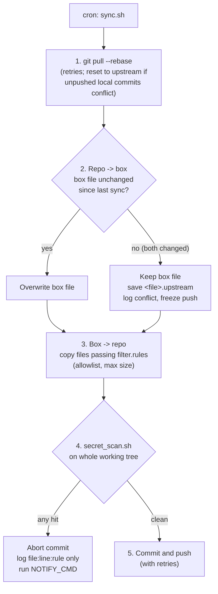

<h1 align="center">git-box-sync</h1>

<p align="center">
  <strong>在 AI 智能体所在的 Linux 机器与 git 仓库之间做双向同步。由白名单和密钥扫描双重把关：只要内容疑似凭据，就拒绝提交。</strong>
</p>

<p align="center">
  <a href="https://github.com/sdpwh7-ux/git-box-sync/actions/workflows/ci.yml"></a>
  <a href="LICENSE"></a>
  
  
</p>

<p align="center">
  <a href="README.md">English</a> | <b>简体中文</b> | <a href="README.ja.md">日本語</a>
</p>

---

## 🤔 为什么需要它

AI 智能体常驻在共享的 Linux 机器（下文称 “box”）上，日积月累会产生不少有用的脚本、配置和技能。你会想把它们纳入 git：方便审查，也能在本地（例如用 Codex）编辑后推送，再让 box 自动拉取这些改动。

问题在于，在智能体的 home 目录里随手执行一次 `git add -A`，API 密钥、cookie、日志和个人文件往往就这样上了 GitHub。

**git-box-sync** 是一个单文件 bash 脚本，设计为由 cron 定时运行（例如每小时一次）。它的默认行为都偏保守：只发布白名单内的文件；不会覆盖 box 上的修改；不会因上游变更而删除 box 上的文件；只要发现疑似密钥，就**拒绝提交**。

## ✨ 功能特性

- 🔁 **双向同步**：一次运行中同时完成仓库 → box 与 box → 仓库两个方向的同步。
- 🛡️ **白名单优先**：只复制通过 `filter.rules`（rsync 过滤语法）的文件，即仅限文本/源码扩展名、不超过 1 MB。日志、状态文件、备份、`.env`、密钥、证书、cookie 以及名称含 `*token*`/`*secret*` 的文件一律排除。
- 🔍 **密钥扫描拦截提交**：检查敏感文件名、私钥头、常见令牌前缀、JWT、UUID、URL 中嵌入的密码，以及字面量形式的 password/token 赋值；如已安装 `gitleaks` 也会一并调用。**任何一处命中都会中止提交。**
- 🙈 **日志不记录密钥值**：命中只以 `file:line:rule` 形式记录，日志和通知都是如此。
- ⚖️ **谨慎处理冲突**：两侧都改了同一文件时，保留 box 版本，上游版本另存为 `<file>.upstream`，并冻结该文件的推送，直到你解决冲突。
- 🗑️ **谨慎处理删除**：上游删除的文件不会从 box 上删除，除非你显式开启；即使开启，文件也只是移入回收目录。
- 🔔 **中止通知**：同步中止时可执行可选的 `NOTIFY_CMD` 钩子。
- 🧰 **扫描器可独立使用**：`secret_scan.sh` 也可以单独对任意目录运行。
- 🐚 **依赖极少**：只需 bash、git、rsync、flock 和 `sha256sum`。Python 3 仅用于解析 gitleaks 的输出。
- 🧪 **有测试覆盖**：测试基于本地 bare 仓库，覆盖过滤、拉取、冲突、密钥拦截和删除。

## ⚙️ 工作原理



1. **拉取**：对同步用克隆执行 `git pull --rebase`，失败会重试。如果本地尚未推送的提交产生冲突，就重置到上游。box 才是事实来源，它的改动会在第 3 步重新生成。
2. **仓库 → box**：应用上游变更，但只有在 box 上的文件自上次同步后未被修改时才覆盖它。如果两侧都改了，则保留 box 文件，把上游版本另存为 `<file>.upstream`，记录冲突，并冻结该文件的推送，直到你解决冲突（删除 `.upstream` 文件即可）。
3. **box → 仓库**：复制通过**白名单**（`filter.rules`）的已变更文件。
4. **密钥扫描**：用 `secret_scan.sh` 扫描整个工作树。检查项包括敏感文件名、私钥头、常见令牌前缀（`sk-`、`ghp_`、`github_pat_`、`xox?-`、`AKIA`、`AIza`、Telegram bot 令牌、JWT）、UUID、URL 中嵌入的密码、字面量 password/token 赋值；如已安装还会调用 `gitleaks`。**任何一处命中都会中止提交。** 日志只记录 `file:line:rule`，从不记录值本身。
5. **提交并推送**，失败会重试。

### 删除规则

| 情形 | 处理方式 |
| --- | --- |
| 文件在**上游**被删除 | 不会从 box 删除。该事件会被记录，此后不再推送该文件。设置 `APPLY_UPSTREAM_DELETES=1` 则改为将此类文件移入回收目录。 |
| 已跟踪文件在 **box 上**被删除 | 从仓库中删除（仍可通过历史记录恢复）。 |
| 文件在**两侧都被修改** | 保留 box 文件；上游版本存为 `<file>.upstream`；记录冲突；冻结推送，直到删除 `.upstream` 文件。 |

## 🚀 快速开始

**环境要求：** bash 4+、git、rsync、flock（util-linux）、coreutils `sha256sum`；仅支持 Linux。Python 3 仅用于解析 gitleaks 输出。

```bash
git clone https://github.com/sdpwh7-ux/git-box-sync.git ~/git-box-sync
git clone git@github.com:you/your-private-box-config.git ~/sync/my-box-config
cp ~/git-box-sync/examples/sync.conf.example ~/git-box-sync/sync.conf   # edit REPO / MAP_REPO / MAP_BOX
~/git-box-sync/sync.sh               # first run
crontab -e                           # 23 * * * * $HOME/git-box-sync/sync.sh
```

扫描器也可以单独使用。发现命中时以退出码 1 结束，并输出 `SECRET-HIT file:line:rule` 行：

```bash
./secret_scan.sh <dir>
```

## 🔧 配置

`sync.conf` 由 bash 以 source 方式加载（参见 `examples/sync.conf.example`）：

| 配置项 | 默认值 | 说明 |
| --- | --- | --- |
| `REPO` | 必填 | 用于同步的本地克隆路径（不要在其中手动操作） |
| `MAP_REPO` / `MAP_BOX` | 必填 | 一组平行数组：仓库顶层目录 <-> box 目录 |
| `RULES` | 脚本同目录下的 `filter.rules` | 应用到每个 box 目录的 rsync 过滤规则 |
| `STATE` | `~/.local/state/git-box-sync` | 存放 manifest、锁、回收目录、`upstream_deleted.txt` |
| `LOG` | `$STATE/sync.log` | 达到 2 MB 时轮转 |
| `MAX_SIZE` | `1m` | 超过此大小的文件永不同步 |
| `REMOTE` | `origin` | 远程仓库名 |
| `APPLY_UPSTREAM_DELETES` | `0` | `1` = 将上游已删除的 box 文件移入 `$STATE/trash/` |
| `NO_PUSH` | `0` | `1` = 只在本地提交，不推送 |
| `NOTIFY_CMD` | - | 同步中止时通过 `bash -c` 执行；可使用 `$TITLE` 和 `$BODY` |
| `SCANNER` | 脚本同目录下的 `secret_scan.sh` | 替换为其他扫描器 |
| `SECRET_SCAN_ALLOWLIST` | 扫描器同目录下的 `allowlist.txt` | 固定字符串；出现在某行时屏蔽该行的命中 |

## 🔐 安全模型

- **请使用私有仓库**存放 box 配置。白名单和扫描器能降低风险，但并不能让公开一个 home 目录变得安全。
- **凭据。** git-box-sync 本身从不读取密钥文件，而是依赖你现有的 git 凭据配置；推荐使用*仅*对该仓库有写权限的 SSH deploy key。请把密钥放在映射目录之外（例如 `~/.config/...`）。扫描器只报告位置，从不输出值，日志和通知中也只有位置信息。
- **文件访问。** 脚本只会写入映射的 box 目录（拉取的变更、`.upstream` 副本）、`REPO` 和 `STATE`，且永远不会因上游变更而删除 box 上的文件。
- ⚠️ **反方向同样是信任边界。** 任何能推送到该仓库的人都能修改 box 上的脚本，而智能体之后可能会执行这些脚本。请保护分支，并像审查以智能体权限运行的代码一样审查推送。
- **Shell。** `sync.conf` 会以 bash 方式 source，请确保它归你所有，且其他用户不可写。`NOTIFY_CMD` 通过 `bash -c` 执行。
- **网络。** 只会对配置的远程仓库执行 `git pull`/`fetch`/`push`。
- **扫描器的局限。** 正则和 gitleaks 能识别常见格式，但无法覆盖一切（例如注释里的裸密码）。扫描通过只是一道安全网，不是保证。

## 🧪 测试

```bash
bash tests/test_sync.sh    # local bare repo; covers filtering, pull, conflict, secret block, deletions
```

## 🗺️ 项目状态

git-box-sync **刚刚开源**。它是一个小巧的单文件 bash 脚本，测试覆盖了上述核心流程，目前只支持 Linux。

我们特别欢迎以下方面的反馈：

- `secret_scan.sh` 的误报和漏报
- `filter.rules` 中的默认白名单
- 冲突和删除处理中不清晰或出乎意料的行为

配置项仍处于早期阶段。在生产 box 上升级前，请先查看变更记录或提交历史。

## 🤝 参与贡献

欢迎提交 Issue 和 Pull Request。

1. Fork 本仓库并创建分支。
2. 保持改动小而聚焦，并让脚本保持轻依赖。
3. 运行 `bash tests/test_sync.sh` 并确认通过。新增的同步或扫描行为请附带测试用例。
4. 提交 Pull Request，并说明行为上的变化。

**切勿在 Issue、PR 或测试用例中包含真实密钥。** 如果你发现了能绕过扫描器的情况，请描述其*模式*，不要粘贴真实的值。

## 📄 许可证

[MIT](LICENSE)

---

### 🧩 智能体工具集成员

| 仓库 | |
| --- | --- |
| [taskwake](https://github.com/sdpwh7-ux/taskwake) | |
| [agent-search-kit](https://github.com/sdpwh7-ux/agent-search-kit) | |
| [streamsafe](https://github.com/sdpwh7-ux/streamsafe) | |
| [agent-usage-ledger](https://github.com/sdpwh7-ux/agent-usage-ledger) | |
| [git-box-sync](https://github.com/sdpwh7-ux/git-box-sync) | 📍 当前仓库 |
